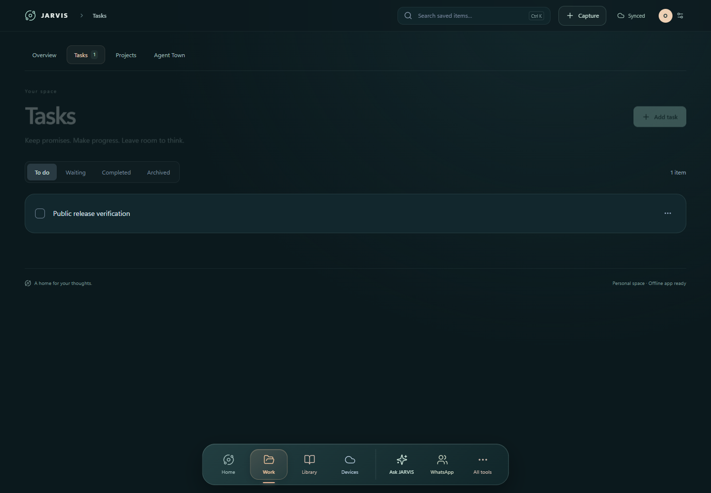
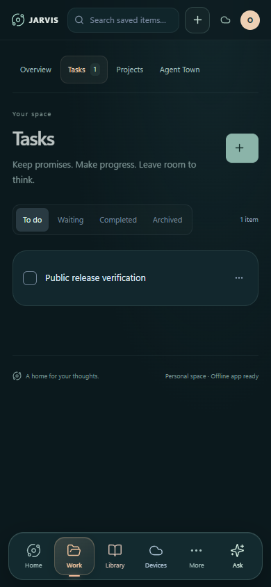

# JARVIS

A personal assistant that lives on your PC. Capture **notes, tasks, projects and people**, talk through your day, and connect your **desktop, Android phone and Wear OS watch** through reviewed, private workflows.

Run the core app on Windows with Node.js and SQLite. Add local **Whisper speech recognition**, **Kokoro or Chatterbox speech generation**, an optional Electron desktop shell, and your own explicitly connected accounts. No personal database, account session, API key, pairing identity, or reference voice is included.

[Get started](docs/SETUP.md) · [Desktop app](docs/DESKTOP.md) · [Android app](docs/ANDROID.md) · [Watch connector](docs/WATCH.md) · [Local voice](docs/VOICE-SETUP.md)

## Screenshots

<table>
  <tr>
    <td align="center"><br>Tasks and workspace navigation</td>
    <td align="center"><br>Phone-sized web interface</td>
  </tr>
</table>

Screenshots use synthetic data in an isolated browser store. They show the responsive web interface, not native Android/watch acceptance or a signed-in personal account.

## Features

### Your personal workspace

- **Capture and organize:** notes, tasks, inbox thoughts, projects, people, tags, dates, search, trash and restore.
- **Conversation:** streamed replies, conversation history, selected record context, model selection, and editable task/note reviews.
- **Personal memory:** explicit recall-enabled records and reviewed memory changes, separate from your AI provider's memory.
- **Reliable saves:** SQLite, browser-local caching, offline queues, revision conflicts, and durable replay receipts.
- **Reviewed actions:** proposing a change does not approve it. Account, recipient, conversation and text remain bound to the relevant review.

### Across your devices

| App | What it adds | Detailed guide |
| --- | --- | --- |
| Windows desktop | Electron toolbar/tray, floating island or orb, optional wake listening, server controls, local coding-session view | [Desktop](docs/DESKTOP.md) |
| Android phone | Private host access, native voice/assistant screens, companion/pet mode, files and device tools | [Android](docs/ANDROID.md) |
| Wear OS watch | Phone-relayed voice, shared-folder browsing, coding summaries, and explicitly trusted laptop controls | [Watch](docs/WATCH.md) |

The PC is the host. Phone and watch features that need the server require it to remain online. Native applications are supplied as source; this release does not contain prebuilt installers/APKs or physical-device acceptance evidence.

### Local speech

Whisper transcribes on your PC. Kokoro 82M provides British Daniel (`bm_daniel`) with an explicit CPU or NVIDIA CUDA engine. Chatterbox Turbo is an optional separate voice engine with upstream watermarking. Models download during your chosen setup; inference uses the installed local workers.

The AI conversation provider is separate from local speech. The direct ChatGPT path needs your own sign-in, compatible provider access and an available model; historical model defaults are not a compatibility promise. No separate paid speech API key is required by the local engines. See the complete [voice installation guide](docs/VOICE-SETUP.md).

## Install on your PC

Install **Node.js 24+** and Git. Open PowerShell:

```powershell
git clone https://github.com/supriyod1999-max/jarvis-personal-assistant.git
cd jarvis-personal-assistant
npm.cmd ci
npm.cmd run build
npm.cmd start
```

Open **http://127.0.0.1:4317**. Keep that exact address because `localhost` has separate browser storage. The app starts with empty local storage. Customize your profile and set your own PIN in Settings; connect services only when you choose them.

For the desktop shell, run `npm.cmd run desktop` after the build. If another JARVIS installation already owns port 4317, do not let this checkout's desktop toolbar manage it. For a separate manual web run, set `$env:PORT = '14317'` and open that port instead.

Normal setup does not install a startup hook, expose a public service, pair a device, download voice models, or connect an external account. [Full setup and backup instructions](docs/SETUP.md).

### Add local voice

Install [uv](https://docs.astral.sh/uv/getting-started/installation/), then choose a setup path. CPU Kokoro is the simplest starting point:

```powershell
powershell.exe -NoProfile -ExecutionPolicy Bypass -File scripts/setup-kokoro.ps1
```

In the unlocked primary workspace, select the installed engine under **Settings → Assistant** and choose **Apply & restart voice**. For microphone input, install compatible OpenWhispr/Whisper prerequisites and run `scripts/setup-input.ps1`. The [voice guide](docs/VOICE-SETUP.md) covers CPU/GPU checks, the current shared CUDA-runtime prerequisite, Chatterbox, model locations, Talk/wake controls, and troubleshooting. No voice reference or credentials from another installation are needed.

### Connect your phone and watch

Configure your own private Tailscale phone route to the separate authenticated **4318** listener, then build the native apps using the documented Android toolchain and asset downloader. Enter your own private HTTPS address in the phone app; pair and approve the exact watch through the phone's biometric/trust flow. Start with [Android setup](docs/ANDROID.md) and [watch pairing](docs/WATCH.md).

**Never expose the unauthenticated desktop listener on 4317.** This app is intended for a personally controlled host, not a public multi-tenant web deployment.

## Integrations and release status

| Component | Included | Separate setup or current boundary |
| --- | --- | --- |
| Records and local web UI | Source and synthetic tests | Ready after install/build/start |
| Direct ChatGPT / legacy Hermes | Connection adapters | Separate authentication; no silent fallback; verify provider compatibility |
| Local speech | Workers, lockfiles and pinned download scripts | Install the selected runtimes/models; no weights or private audio shipped |
| WhatsApp | Selected-chat, draft/review/send adapters | Install compatible OpenWA, pair your own account, choose chats and approve exact sends |
| Instagram | Optional saved-reel adapter | Your own login and media prerequisites; no browser profile shipped |
| Desktop / Android / Wear OS | Source and build/setup instructions | Native prerequisites and device verification needed; no public binary release |
| Agent Town graphics | Host-side filtered reader and unavailable-state UI | Separate compiled world bundle not included |
| Evergreen household | Release-held adapter and technical contracts | No live release configuration or private upstream fixtures; not available as a working integration |

See [integration setup](docs/INTEGRATIONS.md). Account creation/sign-in, device consent, service availability, GPU compatibility and third-party terms cannot be supplied by a repository. The guides distinguish those steps from what the included code installs.

## Privacy and storage

Your records, conversations, credentials, session state, device grants, voice references and local configuration belong in ignored `data/`. Downloaded runtimes belong in ignored `integrations/`. JSON exports and all databases are not universally encrypted; protect them with OS/disk controls and private backups. Local speech does not mean AI conversation text stays offline.

The public snapshot starts with new history and generic identities. Runtime stores, private routes, original handoffs, account sessions, logs, recordings, generated applications and private upstream fixtures were excluded. Both the prospective-file audit and independent secret scan must pass before publication. [Release boundary](docs/PUBLIC-RELEASE.md) · [Security](SECURITY.md).

## Development

```powershell
npm.cmd run dev
npm.cmd test
npm.cmd run build
npx.cmd playwright install chromium
npm.cmd run test:browser
npm.cmd run audit:public
powershell.exe -NoProfile -ExecutionPolicy Bypass -File scripts/scan-secrets.ps1
```

Development uses loopback ports 5173 and 4317. Browser checks use isolated `.test-data` stores and synthetic providers. The release preparation passed 250 included Node tests, a production build, three browser checks and secret scans. See [validation](docs/VALIDATION.md) for unverified native/live integrations and remaining development-dependency advisories. Tests do not send real messages.

## Documentation

- [Install, first run and backups](docs/SETUP.md)
- [Windows desktop app and packaging](docs/DESKTOP.md)
- [Android source build and permissions](docs/ANDROID.md)
- [Wear OS connector, pairing and revocation](docs/WATCH.md)
- [Local speech installation and checks](docs/VOICE-SETUP.md)
- [Configuration](docs/CONFIGURATION.md)
- [Accounts and optional integrations](docs/INTEGRATIONS.md)
- [Optional WhatsApp gateway setup](docs/OPENWA.md)
- [Architecture and data flow](docs/ARCHITECTURE.md)
- [Development and troubleshooting](docs/DEVELOPMENT.md)
- [Public-release review](docs/PUBLIC-RELEASE.md)
- [Validation results](docs/VALIDATION.md)
- [Contributing](CONTRIBUTING.md)
- [Third-party components and distribution limits](THIRD_PARTY_NOTICES.md)

## License

Project-authored source is available under the [MIT License](LICENSE). Third-party software, models, assets and services retain their own licenses and terms. This community project is not affiliated with or endorsed by the services it connects to.
