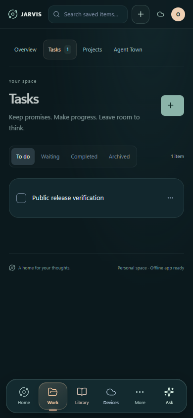

# Android phone app

The phone app combines a WebView of your private JARVIS host with native voice, companion, file-transfer, watch, and device-control screens. Your PC runs the main database, AI connection, Whisper transcription, and speech generation. The phone is not a standalone offline AI host.



This is the mobile **web interface**, captured in an isolated browser test. It is not a native Android screenshot or physical-phone acceptance claim.

## Build requirements

- Android Studio/SDK tools, **SDK 36**, and a compatible JDK (the source targets Java 17).
- Android Gradle Plugin **8.13.0** with the wrapper's **Gradle 8.14.3** distribution.
- Android phone API **28+** for the phone module; particular features may require newer platform APIs/hardware.
- Separately downloaded, hash-verified wake engine/model and music-classification assets.
- Your own signing/distribution plan for releases. No private keystore or prebuilt APK is shipped.

The public application ID is **`org.jarvisassistant.app`**, with a separate `.design` preview variant. It does not overwrite the original personal package.

## Prepare a source build

1. Install the Android SDK/JDK and set `ANDROID_HOME` and `JAVA_HOME` for your computer.
2. Obtain Gradle 8.14.3 from the [official Gradle distributions](https://gradle.org/releases/). Because the binary wrapper JAR is excluded, generate the wrapper locally if needed:

```powershell
gradle -p android wrapper --gradle-version 8.14.3 --distribution-type all
```

3. With Python 3.11+ installed, download the pinned public native assets:

```powershell
python scripts/setup-android-assets.py
python scripts/setup-android-assets.py --check
```

4. Build and check both phone and watch modules:

```powershell
powershell.exe -NoProfile -ExecutionPolicy Bypass -File scripts/build-android.ps1
```

The script sets ignored `android/local.properties`, runs debug assembly, unit tests and lint, and writes local debug APKs. The direct Gradle equivalent is `android\gradlew.bat -p android assembleDebug testDebugUnitTest lintDebug --no-daemon`. The asset checks must pass; do not disable them to force a build. A debug APK is a development artifact, not a reviewed signed public release. No native build was performed on the public export's final source snapshot.

## Connect to your PC

1. Start and validate the desktop/web host. Set your own JARVIS workspace PIN in Settings.
2. Install/sign into Tailscale on the PC and phone using the intended owner identity. Configure private phone access using [INTEGRATIONS.md](INTEGRATIONS.md).
3. Install your own built phone APK through Android's normal owner-approved install flow.
4. Open JARVIS and enter your exact private HTTPS Tailscale address. The example address in source is a placeholder, not a shared server. Ports 443 and 8443 are supported by the endpoint policy.
5. Unlock your workspace and configure optional features one at a time. Device permissions do not replace workspace authentication.

The native endpoint policy rejects non-HTTPS addresses, unexpected host forms, URL credentials, extra query parameters, and unsupported ports. Changing a display name does not change the Tailscale identity or grant access to someone else's workspace.

## Native features and permissions

| Feature | Permission/dependency | What to expect |
| --- | --- | --- |
| Web records and conversations | Private host connectivity | Same host-owned store; browser caching does not make AI offline |
| Talk/background wake | Microphone, notifications, foreground microphone service | Explicit start/stop controls; on-device wake detection, host transcription/reply/audio |
| Floating assistant/pet | Owner-granted display-over-other-apps permission where used | Native foreground/overlay behavior subject to Android/OEM lifecycle rules |
| Camera check-in/reactions | Camera permission when chosen | Native camera/ML paths in source; no camera consent is supplied by the repo |
| Files/downloads | Explicit host-shared folders, network, background-transfer services | Bounded, resumable transfer flow; arbitrary PC folders are not automatically exposed |
| Coding activity | Enabled/unlocked host observation | Session progress; approvals remain in Codex |
| Laptop controls | Separately enrolled phone/host trust; biometric authorization where required | Exact approved operations; not arbitrary remote administration |
| Watch connector | Paired Wear OS device, connected-device foreground service, Google Play Services | Explicit watch selection and separate trust/revocation flow |
| Assistant role | Android's explicit default-assistant selection if supported | Optional; installing the app does not silently make it the system assistant |
| Application updates | Package installer permission/user confirmation as required | Needs your own trusted hosted release metadata and signed APKs |

Only grant permissions for features you choose. A manifest declaration does not mean the permission is granted. OEM battery restrictions, foreground-service rules, device lock state, background microphone limits, and audio routing can affect behavior. This repository does not promise lockscreen/background behavior on all phones.

## Stop, disconnect and recover

Stop listening using its explicit control/notification. Watch trust and watch microphone listening are separate. Revoke devices and shared folders through the relevant app controls before retiring a device. Do not clear private app data or reset PIN/session stores as a verification shortcut.

If a request was interrupted, inspect the resulting state before retrying; ambiguous external sends must not be automatically repeated. If Tailscale or the PC is unavailable, fix connectivity rather than exposing desktop port 4317. Keep phone pairing state, Android keystores, screenshots, and signed packages private unless independently reviewed for distribution.
