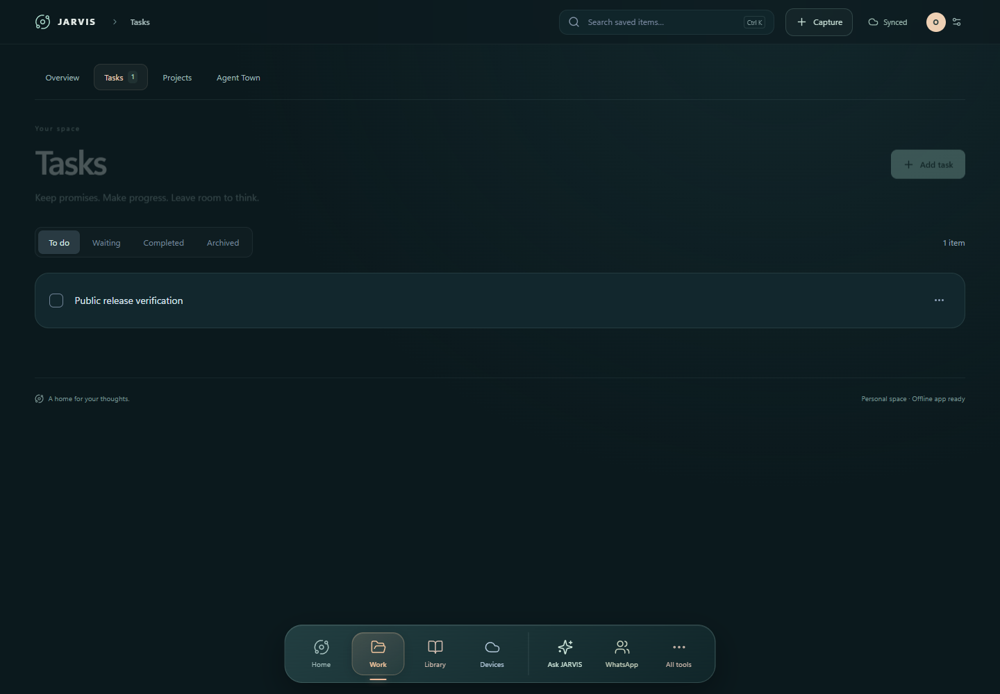

# Windows desktop app

The desktop app is an **Electron shell around the locally hosted JARVIS interface**. The Node server owns your records, accounts, approvals, and speech workers. Electron supplies a native toolbar, tray, floating assistant, and optional desktop observations. It is not a remote hosted account or a portable all-in-one installer.



This screenshot shows the web interface at desktop width in an isolated test store. It does not claim native Electron or live-integration acceptance.

## Install and run

Install Node 24+ and Git, clone the repository, and run:

```powershell
npm.cmd ci
npm.cmd run build
npm.cmd run desktop
```

Use standard loopback port **4317** for desktop-shell operation. If a separate JARVIS installation already owns that port, do not let this shell manage it; stop the other installation deliberately or use this copy's web app on an alternate port. Electron's toolbar controls and configured workspace origins assume standard ports.

The app renderer uses the local server; the restricted native toolbar can run only the fixed Start/Restart/Stop launchers. It does not expose an arbitrary command executor or administrative bridge to the rendered app. The launch supervisor can restart a crashed server, but running the desktop shell does not itself install Windows login startup.

## Main controls

| Control | Behavior |
| --- | --- |
| Workspace selector | Switches explicitly configured personal workspaces; separate records and lock sessions |
| Server/voice readiness | Shows observed service status rather than assuming models are installed |
| Wake | Opt-in local wake listening; requires unlocked workspace and microphone permission |
| Show island / floating orb | Changes how the assistant remains accessible outside the main window |
| Start / restart / stop server | Manages the fixed local launchers; restart awaits shutdown |
| Refresh app | Reloads the rendered local interface |
| Quit desktop, keep server running | Ends the desktop UI and wake capture while leaving the host available |
| Stop server and quit | Stops the managed host and closes the shell |

The tray offers corresponding controls and a way to forget remembered microphone permissions. Keep the distinction between hiding the main window, stopping Talk, disabling wake, quitting Electron, and stopping the server: they have different effects.

## Local voice and privacy

Follow [VOICE-SETUP.md](VOICE-SETUP.md) for Whisper and Kokoro CPU/GPU or Chatterbox. No model weights, reference voice, recordings, or credentials come with the source. A remembered microphone permission is consent to request audio, not automatic microphone activation. Wake is off at launch. Windows lock/suspend and workspace changes invalidate relevant capture and observation state.

The optional Codex session view reads local session activity while the primary workspace is unlocked and monitoring is enabled. It can open the selected session back in Codex. It does not approve Codex actions. The separately built Agent Town graphics bundle is excluded from this release, so its tab explains that the world is unavailable.

## Data and packaging

App settings and credential vaults stay in ignored `data/`; Electron's user-data area is below `data/desktop/`. Records and conversation exports are separate. Back up through the documented app flows and protect private exports.

```powershell
npm.cmd run desktop:package
```

The existing packager writes local output under `output/desktop/` and a generated `desktop/runtime.json` containing the installation path. That package remains tied to this checkout and its server files. Do not publish it as a portable installer, copy runtime.json from another machine, or upload the output without a separate packaging/license review. A public binary release needs portable path handling, clean-machine install tests, dependency notices, signing/distribution decisions, and upgrade/recovery validation.

## Phone and native helpers

Phone access uses Tailscale Serve to a separate **authenticated 4318** loopback listener. Never expose desktop port 4317. The PC must remain online for server-dependent phone/watch features.

Remote desktop input and Windows sign-in helpers are separate native components. Build prerequisites are Visual Studio 2022 C++ Build Tools, Windows SDK, and CMake tools. `scripts/build-remote-control.ps1` and `scripts/build-windows-signin.ps1` build and test their source; they do not establish owner/device consent. Installing a credential provider is an explicit advanced security operation and is not part of ordinary desktop setup. No such provider was installed by this export.
