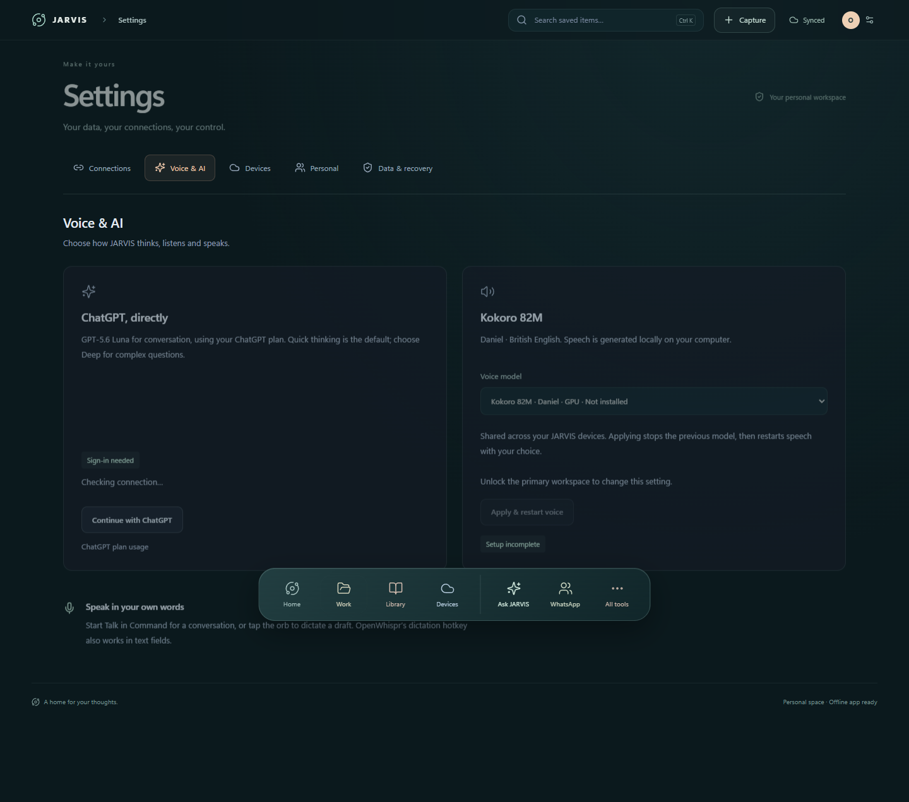

# Local voice: Whisper, Kokoro and Chatterbox

JARVIS separates **speech recognition**, **AI reasoning**, and **speech generation**. Whisper transcribes your recording on the host PC. Your selected conversation provider generates the reply. Kokoro or Chatterbox synthesizes speech on the host PC. Installing local voice does not make the AI conversation model local, sign you into ChatGPT, or connect a messaging account.

No paid speech API key is required by these local workers. Model downloads need internet access initially; the installed speech models run locally. AI replies still require the separately authorized provider and its connectivity/usage allowance.

## Choose an output engine

| Engine | Device | Voice | Setup |
| --- | --- | --- | --- |
| Kokoro 82M, quantized | CPU | `bm_daniel`, British Daniel | Smallest setup path; no NVIDIA GPU required |
| Kokoro 82M, FP32 | NVIDIA CUDA | `bm_daniel`, British Daniel | Shared verified phonemizer/voice assets, separate CUDA worker and runtime prerequisites |
| Chatterbox Turbo | NVIDIA CUDA | Built-in voice, or your permitted reference recording | Separate pinned environment, larger model download, upstream watermarking retained |

The app selects one engine. It does not silently fall back to another engine or from CUDA to CPU. Do not launch competing GPU model workers.



This screenshot is from the isolated, synthetic setup check. “Not installed” is the expected fresh-clone state; it does not show a verified GPU or signed-in AI account.

## Prerequisites

Start with the working text app from [SETUP.md](SETUP.md). Install **uv** using the [official uv instructions](https://docs.astral.sh/uv/getting-started/installation/), then open a new PowerShell window and confirm `uv --version`. On Windows, the documented package-manager command is:

```powershell
winget install --id=astral-sh.uv -e
```

The scripts install pinned Python 3.11.15 into ignored app-local storage. They do not change GPU drivers. Allow sufficient disk space for separate environments, cached wheels, and models; GPU/Chatterbox dependencies can occupy several gigabytes. Run commands from the repository root and read the scripts before choosing downloads.

## 1. Kokoro CPU

```powershell
powershell.exe -NoProfile -ExecutionPolicy Bypass -File scripts/setup-kokoro.ps1
New-Item -ItemType Directory -Force output/qa | Out-Null
& .\integrations\kokoro\.venv\Scripts\python.exe server/kokoro_worker.py --provider cpu --check output/qa/kokoro-cpu.wav
```

The installer verifies a pinned 132,303,094-byte upstream archive and installs hash-locked Python dependencies. Models, phonemizer assets, and a checksum manifest live under `data/voice-models/kokoro/`. The generated check WAV contains synthetic speech and is ignored by Git.

Start JARVIS, unlock the primary workspace, open **Settings → Voice & AI**, choose the installed CPU Kokoro engine, and select **Apply & restart voice**. A fresh installation's saved/default choice may still be Kokoro GPU until you explicitly change it. Use **Test voice** or **Read reply aloud** to check playback.

## 2. Kokoro GPU

The current CUDA worker loads CUDA/cuDNN DLLs from the app-local Torch runtime under `integrations/chatterbox/.venv/Lib/site-packages/torch/lib`. This is a runtime dependency, not permission to run a Chatterbox worker at the same time. It means the GPU path is larger than CPU Kokoro.

With a compatible NVIDIA GPU and existing driver, first prepare CPU Kokoro as above. Then deliberately prepare the pinned Chatterbox/Torch environment, let its one-shot check exit, and install Kokoro GPU:

```powershell
powershell.exe -NoProfile -ExecutionPolicy Bypass -File scripts/setup-voice.ps1
powershell.exe -NoProfile -ExecutionPolicy Bypass -File scripts/setup-kokoro-gpu.ps1
& .\integrations\kokoro-gpu\.venv\Scripts\python.exe server/kokoro_worker.py --provider cuda --check output/qa/kokoro-gpu.wav
```

This downloads pinned assets including the CUDA sherpa-onnx wheel and FP32 Kokoro model, with SHA-256 verification. Select **Kokoro GPU** and **Apply & restart voice** only after its check passes. If required DLLs, CUDA device access, or GPU memory are unavailable, stop and resolve the prerequisite; do not disable checks or silently switch engines. The repo does not establish a universal GPU/driver compatibility matrix.

## 3. Chatterbox alternative

```powershell
powershell.exe -NoProfile -ExecutionPolicy Bypass -File scripts/setup-voice.ps1
```

The script checks out a pinned upstream revision, installs the locked runtime, downloads pinned model files, and generates a one-shot check WAV. Do not run it while another voice worker is using the GPU. Select Chatterbox explicitly in Settings after installation.

A reference voice is optional. If you choose one, use only audio you have permission to use, keep it private at `data/voice-reference/current.wav`, and preserve upstream watermarking. No reference from the private installation is distributed. Without one the worker reports its built-in voice. Voice cloning permissions and model terms remain your responsibility.

## 4. Whisper speech input

Install the Windows version of [OpenWhispr](https://openwhispr.com/download), select local transcription, and download **Whisper Base** there. Then run:

```powershell
powershell.exe -NoProfile -ExecutionPolicy Bypass -File scripts/setup-input.ps1
```

The script looks for the packaged runtime in `%LOCALAPPDATA%/Programs/OpenWhispr/resources/bin/` and the downloaded model in `%USERPROFILE%/.cache/openwhispr/whisper-models/`. It checks the Base model against the pinned SHA-256 and copies only required runtime files into ignored `integrations/whisper/`. It does not change OpenWhispr's installation or use browser SpeechRecognition.

OpenWhispr's layout may change; if these files are absent, use a compatible upstream runtime layout and inspect the script rather than copying private configuration. The included `download-input.py` is an alternative model downloader, not a substitute for installing the Whisper server executable.

## 5. Use Talk and wake listening

Complete your separate AI sign-in, confirm the selected speech workers are available, and choose **Start Talk**. The greeting begins with the microphone muted; enable the microphone when ready. Stop or mute from the UI. Desktop wake listening is separately opt-in and off on launch; lock, workspace switch, suspend, and desktop exit stop it. Android/watch listening has its own device controls and permissions, documented in their guides.

`JARVIS_VOICE_STANDBY=1` opts into warming the selected installed voice worker at server startup. The public release leaves this off by default. Installing Chatterbox prerequisites for Kokoro CUDA does not select or preload the Chatterbox model during normal Kokoro operation.

## Privacy and verification

Ambient desktop speech is discarded unless a configured wake phrase is detected. Explicit speech requests are bounded; the server accepts mono 16 kHz recordings from 0.35 to 30 seconds. Transcribed requests and AI replies can become conversation records. Do not confuse local audio processing with a guarantee that conversation text never reaches your selected AI provider.

Check the UI's service status, one-shot WAV, actual playback, and microphone stop behavior. The public export's automated tests use synthetic workers; a fresh download, physical microphone, GPU, and provider connection have not been accepted on every machine. Keep `data/`, `integrations/`, recordings, and generated test audio out of Git.

