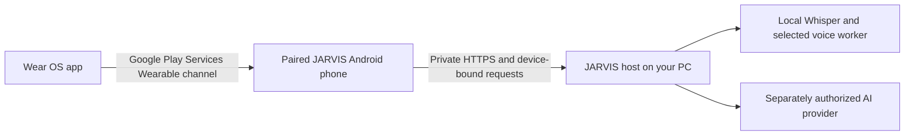

# Wear OS connector

The watch component is a **Wear OS app relayed through your explicitly paired Android phone**. It is not an Apple Watch app, standalone cloud service, or direct public connection to the PC. Several UI labels say Galaxy Watch because that was the original target; other Wear OS devices have not been accepted by this public source export.

The phone and host must be reachable for server-dependent actions. The watch does not need to share or store your ChatGPT/OpenWA credentials. Installing the watch APK does not establish trust.

## Requirements and install

Build the `:wear` module alongside the phone app following [ANDROID.md](ANDROID.md). The source sets watch minimum API **30**, requires a watch device, and uses Google Play Services Wearable APIs. Use an ordinary owner-approved Wear OS developer installation process; no watch package or signing key is included.

Pair the physical watch with the phone through its vendor's normal companion app first (the source troubleshooting text mentions Galaxy Wearable). Keep exactly one connected phone during setup: the watch deliberately refuses ambiguous node selection. Enable required microphone/notification permissions only when you choose voice features.

## Pair in JARVIS

1. Connect the Android app to your own private host and unlock the primary workspace.
2. Complete any separate phone/laptop enrollment required by the native Computer controls. Watch trust relies on that enrolled phone identity; a web PIN by itself is not the device-signing key.
3. Install/open JARVIS on the paired watch.
4. On the phone, open **Galaxy Watch**, choose **Find paired watches**, and select the exact device.
5. Complete the phone's strong biometric approval for **Trust your Galaxy Watch**. This authorizes the identified watch/phone/computer binding; it is not a grant to any device with the same display name.
6. Enable the watch connection, then inspect its observed connection status.

Trust is stored durably on the host and can be revoked. The 60-second enrollment challenge binds the computer, enrolled phone, watch key, paired-node digest, nonce and expiry. Ordinary trusted-watch requests use a new short-lived challenge bound to exact operation and argument digest. Requests are consumed once; interrupted operations are not automatically resent.

## Features

| Watch feature | Behavior and boundary |
| --- | --- |
| Talk to JARVIS | General conversation via phone and host; private records/actions continue through the phone's reviewed flow |
| Spoken replies | Host-generated local audio played on the watch; per-watch quiet/spoken preference |
| Wake listening | Explicit 15-minute, one-hour, or until-stopped choices; off by default, not restarted after reboot/app stop |
| Files | Lists only host-approved shared roots/folders; choosing a file requests its download on the **phone**, not unrestricted watch filesystem access |
| Codex | Up to eight recent host-supplied session summaries; does not approve or execute coding tasks |
| Laptop input | Trusted-watch media/pointer/click/scroll/bounded text/key operations, subject to unlocked-watch and host checks |
| Lock/unlock | Opens the phone's review/biometric path; the watch does not independently approve Windows sign-in |
| Watch tile | Entry point into the watch app; not an always-on microphone grant |
| Updates | Can use a phone-relayed trusted package flow after you configure your own signed release channel |

The source contains both the newer **trusted-watch tools** and older **phone-mediated media buttons**. These are distinct: the legacy media flow asks for a 15-minute phone fingerprint approval, while the trusted-watch tool screen describes input authorization through durable watch trust and unlocked-watch signatures. Do not assume either UI text grants every control without its server/device checks.

## Voice privacy and battery

The watch's local wake detector decides when to capture an utterance for the host. Host-side Whisper transcribes; the selected AI provider answers; the selected PC speech engine synthesizes audio. Local speech does not mean the language model runs on the watch. Explicit utterances and their replies may be retained in conversation records; private credentials stay on their owning host.

Long listening uses battery and requires an active foreground service/notification. Listening duration and paired trust duration are separate. **Disconnect watch** on the phone stops its bridge/local selection, but listening is controlled separately on the watch; stop it there too. Revoke durable trust through the host's device controls when retiring a watch. Revoking the parent phone identity also invalidates associated watch authority.

## Troubleshooting and acceptance

If no phone is found, check the vendor pairing, Bluetooth/connected-device permission, Google Play Services, and JARVIS phone bridge. If more than one node is found, resolve the ambiguity instead of silently selecting the first device. If the host is unreachable, check the PC and private Tailscale route. If signing/biometrics fail, complete legitimate enrollment rather than substituting a test key or synthetic token.

Automated tests cover synthetic protocol, expiry, ownership and request-boundary behavior. This export does not claim physical watch pairing, background microphone/battery acceptance, cross-vendor interoperability, APK update delivery, or Windows credential-provider acceptance. Native device screenshots are intentionally absent until a sanitized physical-device review exists.
